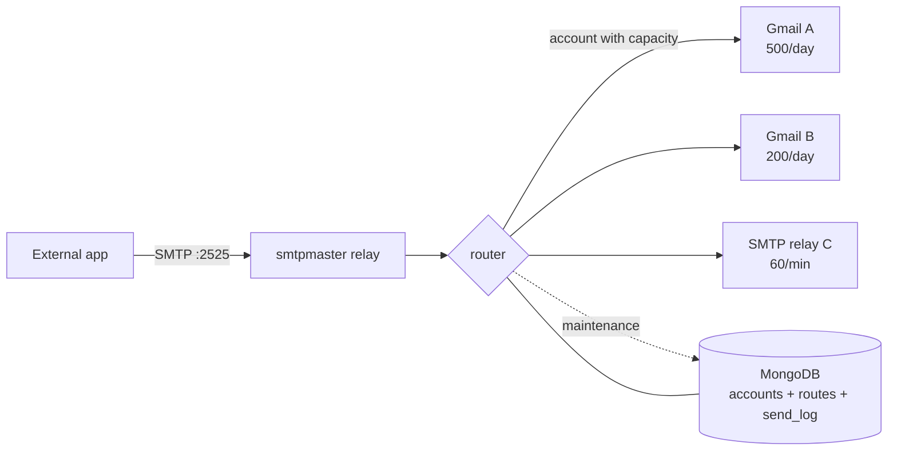

# smtpmaster

**English** | [Tiếng Việt](README.vi)

SMTP router written in Rust: external apps send mail to one SMTP relay, and the
router distributes it across SMTP accounts stored in MongoDB — with quotas,
rate limits, per-account daily resets, expiry, priorities and isolated tenant
pools.



## Features

- **Account CRUD** in MongoDB: add/list/show/update/delete, enable/disable.
- **Daily quota window**: `--count-max` (0 = unlimited), reset at a per-account
  local time (`--reset-at 03:30 --timezone Asia/Ho_Chi_Minh`).
- **Package cap**: `--total-max` limits successful sends over the account's
  lifetime (0 = unlimited).
- **Rate limit**: token bucket per minute (`--rate-limit 60`), burst equals one
  minute of quota.
- **Expiry**: `--expires-in 15d|3m|2y|36h` or `--expires-at RFC3339`; expired
  accounts are excluded from routing and disabled automatically.
- **Routing modes**: `priority`, `round-robin`, `time-window`; parallel
  (`--concurrency N`) or sequential (`--sequential`).
- **Time windows**: per account `[days] HH:MM-HH:MM[@priority]`, including
  windows that cross midnight and priority overrides.
- **Atomic reservation**: quota, package cap, rate limit, expiry and daily
  rollover are checked and updated in one MongoDB `findOneAndUpdate` pipeline,
  so concurrent apps cannot exceed quota.
- **Failover**: a failed send is refunded (not counted as quota), the account
  records the error, and the message moves to the next account. When every
  eligible account fails, each one records the failure and the app receives a
  `451`; the router does not retry internally.
- **Tenant routes**: each inbound identity owns a pool of outbound accounts, so
  app 1 can never use app 2's accounts. Routes make AUTH mandatory.
- **One send per account at a time**: busy accounts are skipped for the next
  message; idle accounts send in parallel across apps.
- **SMTP relay** with optional AUTH PLAIN/LOGIN, message/recipient/connection
  limits.
- **Optional web dashboard**, enabled/disabled from the CLI at runtime without
  restarting the relay, protected by a bearer token.
- **Daemon mode** (`serve --daemon`) with PID and log files.
- **systemd unit generation** (`service install`) for auto-start.
- **Send log** in `send_log` (TTL) plus `stats`.

## Requirements

- Linux (release builds: static musl amd64/arm64).
- MongoDB ≥ 6 (`$expr`, `$$NOW`, update pipelines).
- Google accounts need 2FA and an **App Password** (plain passwords are usually
  rejected for SMTP AUTH).

## Install

### mise (recommended)

```sh
mise use -g github:manhavn/smtpmaster
smtpmaster --version
```

Pin a specific release artifact through the `http` backend (the
`mise-tools.toml` file attached to each release):

```toml
[tools]
"http:smtpmaster" = { version = "0.1.0", url = 'https://github.com/manhavn/smtpmaster/releases/download/v{{ version }}/smtpmaster-{{ version }}-linux-musl-{{ arch(x64="amd64") }}.tar.gz' }
```

```sh
mkdir -p ~/smtpmaster && cd ~/smtpmaster
cp /path/to/mise-tools.toml mise.toml
mise install
mise exec -- smtpmaster --version
```

### Tarball

```sh
tar -xzf smtpmaster-0.1.0-linux-musl-amd64.tar.gz
install -m 0755 smtpmaster ~/.local/bin/
```

## Configuration

Copy `config.example.toml` to `smtpmaster.toml` (or pass `--config`). Every
value can be overridden with `SMTPMASTER_*` environment variables:
`SMTPMASTER_MONGODB_URI`, `SMTPMASTER_MONGODB_DB`, `SMTPMASTER_LISTEN`,
`SMTPMASTER_MODE`, `SMTPMASTER_CONCURRENCY`, `SMTPMASTER_SEQUENTIAL`,
`SMTPMASTER_AUTH_REQUIRED`, `SMTPMASTER_USERS="user:pass,user2:pass2"`,
`SMTPMASTER_LOG`, …

```toml
[mongodb]
uri = "mongodb://127.0.0.1:27017"
database = "smtpmaster"

[server]
listen = "0.0.0.0:2525"
hostname = "smtpmaster.local"
mode = "priority"          # priority | round-robin | time-window
concurrency = 8            # max concurrent upstream sends
sequential = false         # true = one message at a time
max_attempts = 0           # 0 = try every eligible account
fail_threshold = 5
auth_required = false
rewrite_from_header = false

[[server.users]]
username = "relay"
password = "change-me"
```

## Managing accounts

```sh
# Google account (app password), 500 sends/day, reset at 03:30 Vietnam time,
# expires in 3 months, priority 10, 60 sends/minute, 50k lifetime cap
smtpmaster account add \
  --name gmail-a --provider google \
  --username bot@example.com --password-env GMAIL_APP_PASSWORD \
  --count-max 500 --rate-limit 60 --total-max 50000 \
  --reset-at 03:30 --timezone Asia/Ho_Chi_Minh \
  --expires-in 3m --priority 10

# Custom relay, only inside the weekday 08:00-17:00 window
smtpmaster account add \
  --name relay-b --provider smtp --host smtp.example.com --port 587 \
  --tls starttls --username user --password-stdin --from mail@example.com \
  --count-max 2000 --window "mon-fri 08:00-17:00" \
  --expires-at 2027-01-01T00:00:00Z

smtpmaster account list
smtpmaster account show gmail-a
smtpmaster account update gmail-a --count-max 800 --rate-limit 120
smtpmaster account update gmail-a --expires-in 2y
smtpmaster account disable gmail-a --reason "maintenance"
smtpmaster account enable gmail-a
smtpmaster account test gmail-a --to you@example.com
smtpmaster account delete gmail-a --yes
```

Window format: `[days] HH:MM-HH:MM[@priority]`

- `days`: `*` (default), `mon-fri`, `mon,wed,fri`, or `0-6` (Mon = 0).
- `@priority` overrides the account priority while the window is active.
- Multiple `--window` options: the first matching window is used; windows such
  as `22:00-02:00` cross midnight.

Quota semantics: `count_max` is the maximum number of sends in one **daily
window**; the window starts at `reset_at` in the account's `timezone`. `0`
means unlimited. `rate_limit` is sends/minute with a token bucket. `total_max`
caps successful sends over the account's lifetime.

## Multi-tenant routes

A `route` binds an inbound SMTP AUTH identity to its own outbound account pool.
Once any route exists, the relay **requires AUTH** and each message can only go
through the authenticated route's pool — apps cannot use each other's accounts.

```sh
smtpmaster route add --name app1 --username app1 --password-env APP1_PASS \
  --account gmail-a --account gmail-b
smtpmaster route add --name app2 --username app2 --password-stdin \
  --account relay-c --account relay-d

smtpmaster route list
smtpmaster route show app1 --json
smtpmaster route update app1 --account gmail-c
smtpmaster route disable app2
smtpmaster route delete app2 --yes
```

End-to-end flow: `app → AUTH (route) → route pool → 250/451`. Errors, retries
and quota for app1 only affect app1's pool. Without routes, the relay uses
`server.users` and the global account list as before.

## Quota and error accounting

- **Successful send**: `count_used` +1 (daily window), `total_sent` +1
  (package cap), `consecutive_failures` reset, `send_log` status `sent`.
- **Failed send**: `count_used` refunded (the send does not consume quota),
  `consecutive_failures` +1, `last_error` stored, `send_log` status `failed`.
- `max_attempts = 0` (default) tries **every** account with remaining capacity
  in the pool. If all fail, every attempted account records the failure and the
  app receives `451`; the message is not retried internally.
- Each account sends **one message at a time**; messages from other apps are
  routed to the next idle account instead of queueing behind a busy one.

## Running the relay

```sh
smtpmaster init                 # create indexes, verify MongoDB
smtpmaster serve                # reads smtpmaster.toml
smtpmaster serve --mode round-robin --concurrency 16
smtpmaster serve --sequential   # one message at a time
```

Point external apps at `smtpmaster:2525` as a normal SMTP server. If
`auth_required` is set (or routes exist), clients must use `AUTH PLAIN` or
`AUTH LOGIN`.

- `250` — delivered through an account (returns a message id).
- `451` — temporarily out of capacity or upstream failure; retry later.
- `530` — AUTH required; `535` — bad credentials.

Selection modes:

| mode | Behavior |
|---|---|
| `priority` | lower `priority` first; ties go to the account used least recently |
| `round-robin` | least recently used account first (priority breaks ties) |
| `time-window` | like `priority`, but schedules decide eligibility and may override priority |

### Daemon mode

```sh
smtpmaster serve --daemon
smtpmaster serve --daemon --pid-file /run/smtpmaster.pid --log-file /var/log/smtpmaster.log
kill "$(cat "${XDG_STATE_HOME:-$HOME/.local/state}/smtpmaster/smtpmaster.pid")"
```

Logs and PID default to `$XDG_STATE_HOME/smtpmaster/` (usually
`~/.local/state/smtpmaster/`). A live PID file makes a second start fail. On
machines with systemd, prefer `smtpmaster service install`.

## Web dashboard (optional)

```sh
smtpmaster admin enable --token "$(openssl rand -hex 24)" --listen 127.0.0.1:8787
smtpmaster admin status
smtpmaster admin disable
```

Open `http://127.0.0.1:8787` and enter the token. Every `/api/*` request needs
`Authorization: Bearer <token>`; tokens must be at least 16 characters and are
always displayed masked. The default bind is loopback — switching to `0.0.0.0`
prints a warning. Put it behind a TLS reverse proxy if exposed.

The dashboard shows stats, accounts (enable/disable/reset, edit count max,
total max, rate limit, priority), routes (enable/disable) and the last 50
sends. The enabled flag lives in MongoDB and the running `serve` process polls
it every 2 seconds, so toggling needs **no restart** and does not interrupt
active SMTP sessions.

## Maintenance and stats

```sh
smtpmaster maintenance          # reset quota windows + disable expired accounts
smtpmaster maintenance --watch --interval 30
smtpmaster stats
smtpmaster stats --json
```

`serve` runs maintenance periodically (`maintenance.interval_secs`). You can
also run `maintenance` from cron/a systemd timer.

Security note: SMTP passwords and the dashboard token are stored in MongoDB
(required for upstream AUTH); restrict database access. Passwords are always
masked in output. Prefer `--password-env`/`--password-stdin` over `--password`
on the command line.

## Auto-start with systemd

```sh
# System unit (needs root), config path embedded in ExecStart
sudo smtpmaster service install --config /etc/smtpmaster.toml

# Inspect the generated unit without writing anything
smtpmaster service print --user

# User unit (no root required)
smtpmaster service install --user
loginctl enable-linger "$USER"   # start at boot without a login session

smtpmaster service status
sudo smtpmaster service uninstall
```

`service install` uses the current binary (or `--bin`), embeds the resolved
config path, adds `--env KEY=VALUE` variables (default `SMTPMASTER_LOG=info`),
sets `Restart=on-failure`, `LimitNOFILE=65536` and basic hardening. Options:
`--dry-run`, `--no-start`, `--force`. Alias: `smtpmaster autostart install`.

## Release build (no CI)

```sh
./scripts/build-release.sh
```

The script:

1. Picks a toolchain: **mise → container (podman, then docker) → system**.
2. Installs missing tools automatically (mise: `rust`, `zig`,
   `cargo-zigbuild`).
3. Builds static musl binaries for `x86_64-unknown-linux-musl` and
   `aarch64-unknown-linux-musl` with `-D warnings` (warning-free).
4. Verifies the binaries are static, then packages them with both READMEs,
   LICENSE and the example config.
5. Writes `outputs/SHA256SUMS`, `outputs/mise-tools.toml` and
   `outputs/release-notes.md`.

Options: `--provider`, `--targets`, `--version`, `--output`, `--no-strict`,
`--keep-stage`. Upload manually:

```sh
cd outputs && gh release create v0.1.0 ./*.tar.gz SHA256SUMS mise-tools.toml \
  --title "smtpmaster v0.1.0" --notes-file release-notes.md
```

Container only: `--provider container` uses
`ghcr.io/rust-cross/cargo-zigbuild`. Local only: `--provider system` (needs
`zig` or `musl-gcc`/`aarch64-linux-musl-gcc`).

## Tests

```sh
./scripts/test.sh          # starts a temporary MongoDB, runs tests + clippy
SMTPMASTER_TEST_MONGO_URI=mongodb://127.0.0.1:27017 cargo test --all-targets
```

Coverage: unit tests (durations, schedules, SMTP protocol, service units),
real-MongoDB tests (quota, package cap, rate limit, expiry, reset, routes) and
end-to-end tests (SMTP client → relay → fake upstream, both AUTH directions)
plus dashboard API and live enable/disable tests.

## Layout

```
src/
  cli.rs          # clap commands and command handlers
  config.rs       # TOML + env overrides
  model.rs        # Account, quota window, expiry, admin settings
  route.rs        # inbound identity + outbound account pool
  store.rs        # MongoDB CRUD + atomic reservation
  router.rs       # account selection, failover, send log
  smtp/server.rs  # SMTP relay
  smtp/client.rs  # upstream SMTP client (STARTTLS/implicit TLS)
  smtp/protocol.rs# reply parsing, dot-stuffing, From rewriting
  admin.rs        # token-protected dashboard + runtime toggle
  schedule.rs     # time windows
  duration.rs     # 15d / 3m / 2y
  maintenance.rs  # quota reset + expiry sweep
  service.rs      # systemd unit generation
assets/admin.html # dashboard UI (vanilla JS, no CDN)
```

## Known limitations

- A message is delivered entirely through one account; recipients are not split
  across accounts.
- No HTTP metrics/Prometheus endpoint; observe via `send_log`, `stats` and
  tracing logs.
- The relay reads commands sequentially; pipelined clients work through TCP
  buffering but are not optimized.
- Upstream TLS trusts Mozilla roots from `webpki-roots`, not the OS CA store.
