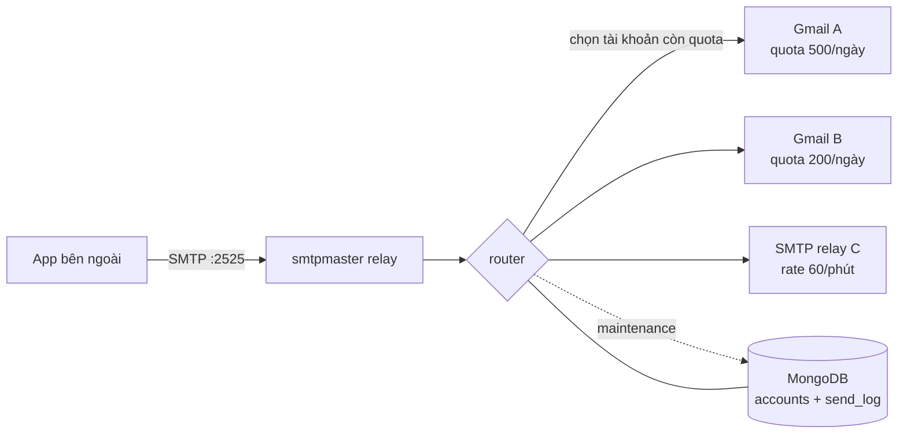

# smtpmaster

CLI bằng Rust để **điều phối SMTP như một router**: nhận mail từ app bên ngoài qua
một SMTP relay duy nhất, rồi phân phối sang nhiều tài khoản SMTP (Google hoặc
relay bất kỳ) được quản lý trong MongoDB — kèm quota, rate limit, lịch reset
theo từng tài khoản, thời hạn và các chế độ ưu tiên.



## Tính năng

- **CRUD tài khoản** trong MongoDB: thêm/sửa/xóa, bật/tắt (`enable`/`disable`).
- **Quota theo cửa sổ ngày**: `--count-max` (0 = không giới hạn), mỗi tài khoản
  reset ở giờ riêng (`--reset-at 03:30 --timezone Asia/Ho_Chi_Minh`).
- **Hạn mức trọn gói**: `--total-max` chặn tổng số mail thành công của cả vòng
  đời tài khoản (0 = không giới hạn), phù hợp với gói mua theo số lượng.
- **Rate limit**: token bucket theo phút (`--rate-limit 60`), burst tối đa bằng
  quota một phút.
- **Thời hạn tài khoản**: `--expires-in 15d|3m|2y|36h` hoặc `--expires-at
  RFC3339`; hết hạn tự động bị loại khỏi routing và bị disable.
- **Chế độ routing**: `priority`, `round-robin`, `time-window`; chạy song song
  (`--concurrency N`) hoặc tuần tự (`--sequential`).
- **Khung giờ / ưu tiên theo giờ**: mỗi tài khoản có danh sách window
  `[days] HH:MM-HH:MM[@priority]`, có hỗ trợ window qua nửa đêm.
- **Atomic reservation**: quota + rate + expiry + reset cửa sổ được kiểm tra và
  cập nhật trong **một** `findOneAndUpdate` pipeline của MongoDB, nên nhiều
  connection đồng thời không thể vượt quota.
- **Failover**: gửi lỗi thì hoàn quota và thử tài khoản kế tiếp
  (`--max-attempts`); tự disable sau N lỗi liên tiếp (`fail_threshold`).
- **Relay SMTP** có AUTH PLAIN/LOGIN (tuỳ chọn), giới hạn kích thước message,
  số recipient, số connection.
- **Log gửi** trong collection `send_log` (TTL theo ngày), thống kê `stats`.
- **Tự khởi động**: `smtpmaster service install` sinh systemd unit (system hoặc
  `--user`), `autostart` là alias. `service print/status/uninstall` có sẵn.

## Yêu cầu

- Linux (build release: musl amd64/arm64).
- MongoDB ≥ 6 (dùng `$expr`, `$$NOW`, update pipeline).
- Với tài khoản Google: bật 2FA và tạo **App Password** (SMTP AUTH thường bị
  chặn nếu dùng mật khẩu tài khoản).

## Cài đặt

### Qua mise (khuyến nghị)

Mỗi bản release có sẵn `mise-tools.toml`:

```toml
[tools]
"http:smtpmaster" = { version = "0.1.0", url = 'https://github.com/OWNER/smtpmaster/releases/download/v{{ version }}/smtpmaster-{{ version }}-linux-musl-{{ arch(x64="amd64") }}.tar.gz' }
```

```sh
mkdir -p ~/smtpmaster && cd ~/smtpmaster
cp /path/to/mise-tools.toml mise.toml
mise install
mise exec -- smtpmaster --version
```

### Từ tarball

```sh
tar -xzf smtpmaster-0.1.0-linux-musl-amd64.tar.gz
install -m 0755 smtpmaster ~/.local/bin/
```

## Cấu hình

Copy `config.example.toml` thành `smtpmaster.toml` (hoặc trỏ `--config`).
Mọi giá trị đều có thể override bằng biến môi trường `SMTPMASTER_*`:
`SMTPMASTER_MONGODB_URI`, `SMTPMASTER_MONGODB_DB`, `SMTPMASTER_LISTEN`,
`SMTPMASTER_MODE`, `SMTPMASTER_CONCURRENCY`, `SMTPMASTER_SEQUENTIAL`,
`SMTPMASTER_AUTH_REQUIRED`, `SMTPMASTER_USERS="user:pass,user2:pass2"`,
`SMTPMASTER_LOG`, `SMTPMASTER_MAX_MESSAGE_SIZE`, …

```toml
[mongodb]
uri = "mongodb://127.0.0.1:27017"
database = "smtpmaster"

[server]
listen = "0.0.0.0:2525"
hostname = "smtpmaster.local"
mode = "priority"          # priority | round-robin | time-window
concurrency = 8            # số mail gửi song song tối đa
sequential = false         # true = gửi lần lượt
max_attempts = 3
fail_threshold = 5
auth_required = false
rewrite_from_header = false

[[server.users]]
username = "relay"
password = "change-me"
```

## Quản lý tài khoản

```sh
# Thêm tài khoản Google (app password), quota 500/ngày, reset 03:30 giờ VN,
# hết hạn sau 3 tháng, ưu tiên 10, giới hạn 60 mail/phút
smtpmaster account add \
  --name gmail-a --provider google \
  --username bot@example.com --password-env GMAIL_APP_PASSWORD \
  --count-max 500 --rate-limit 60 --total-max 50000 \
  --reset-at 03:30 --timezone Asia/Ho_Chi_Minh \
  --expires-in 3m --priority 10

# Thêm SMTP relay riêng, chỉ dùng trong khung 08:00-17:00 các ngày làm việc
smtpmaster account add \
  --name relay-b --provider smtp --host smtp.example.com --port 587 \
  --tls starttls --username user --password-stdin --from mail@example.com \
  --count-max 2000 --window "mon-fri 08:00-17:00" \
  --expires-at 2027-01-01T00:00:00Z

smtpmaster account list
smtpmaster account show gmail-a
smtpmaster account update gmail-a --count-max 800 --rate-limit 120
smtpmaster account update gmail-a --expires-in 2y
smtpmaster account disable gmail-a --reason "đang kiểm tra"
smtpmaster account enable gmail-a
smtpmaster account test gmail-a --to you@example.com
smtpmaster account delete gmail-a --yes
```

Định dạng `--window`: `[days] HH:MM-HH:MM[@priority]`

- `days`: `*` (mặc định), `mon-fri`, `mon,wed,fri`, số `0-6` (Mon = 0).
- `@priority` thay cho priority của tài khoản khi window đang hoạt động.
- Nhiều `--window` = dùng window đầu tiên khớp; window `22:00-02:00` bao qua
  nửa đêm.

Ý nghĩa quota: `count_max` là số mail tối đa trong một **cửa sổ ngày**; cửa sổ
bắt đầu tại `reset_at` theo `timezone` của tài khoản. `0` = không giới hạn.
`rate_limit` là số mail/phút; token bucket được nạp lại liên tục và cho phép
burst bằng đúng quota một phút. `total_max` là tổng số mail gửi thành công tối
đa trong vòng đời tài khoản (gói quota).

## Chạy relay

```sh
smtpmaster init                 # tạo index, kiểm tra MongoDB
smtpmaster serve                # đọc smtpmaster.toml
smtpmaster serve --mode round-robin --concurrency 16
smtpmaster serve --sequential   # gửi lần lượt từng mail một
```

Trỏ app bên ngoài vào `smtpmaster:2525` như một SMTP server thường. Nếu bật
`auth_required`, client phải `AUTH PLAIN` hoặc `AUTH LOGIN` bằng user trong cấu
hình. Response:

- `250` — đã gửi thành công qua một tài khoản (kèm message id).
- `451` — tạm thời hết quota / lỗi upstream; client nên retry.
- `530` — cần AUTH; `535` — sai thông tin đăng nhập.

Chế độ chọn tài khoản:

| mode | Ý nghĩa |
|---|---|
| `priority` | `priority` nhỏ hơn được chọn trước, cùng priority thì tài khoản lâu chưa dùng được chọn trước |
| `round-robin` | tài khoản lâu chưa dùng nhất trước (priority phá hoà) |
| `time-window` | như `priority`, nhưng window đang hoạt động có thể override priority; ngoài window thì tài khoản không được dùng |

`--sequential` ép 1 worker; mặc định số mail gửi song song tối đa là
`concurrency`.

## Tự khởi động cùng systemd

```sh
# Unit hệ thống (cần root), nhúng config tuyệt đối vào ExecStart
sudo smtpmaster service install --config /etc/smtpmaster.toml

# Xem unit sẽ tạo mà không ghi gì
smtpmaster service print --user

# Unit cấp user (không cần root)
smtpmaster service install --user
loginctl enable-linger "$USER"   # tự chạy cả khi chưa đăng nhập

smtpmaster service status
sudo smtpmaster service uninstall
```

`service install` dùng chính binary đang chạy (hoặc `--bin`), nhúng đường dẫn
config đã resolve, thêm biến môi trường bằng `--env KEY=VALUE` (mặc định
`SMTPMASTER_LOG=info`), đặt `Restart=on-failure`, `LimitNOFILE=65536` và
hardening cơ bản. Có `--dry-run`, `--no-start`, `--force`. Alias tương đương:
`smtpmaster autostart install`.

## Vận hành

```sh
smtpmaster maintenance          # reset cửa sổ quota + disable tài khoản hết hạn
smtpmaster maintenance --watch --interval 30
smtpmaster stats
smtpmaster stats --json
```

`serve` tự chạy maintenance định kỳ (`maintenance.interval_secs`). Có thể chạy
`maintenance` bằng cron/systemd timer thay thế.

Lưu ý bảo mật: mật khẩu SMTP được lưu trong MongoDB (cần cho AUTH upstream).
Hãy giới hạn quyền truy cập database và tránh `--password` trần trong shell
history — dùng `--password-env` hoặc `--password-stdin`. Output `account list`
luôn che mật khẩu.

## Build release (không dùng CI)

```sh
./scripts/build-release.sh
```

Script sẽ:

1. Chọn toolchain theo thứ tự **mise → container (podman, rồi docker) → system**.
2. Tự cài tool còn thiếu (mise: `rust`, `zig`, `cargo-zigbuild`).
3. Build tĩnh musl cho `x86_64-unknown-linux-musl` và
   `aarch64-unknown-linux-musl` với `-D warnings` (build sạch warning).
4. Kiểm tra binary thật sự static, đóng gói kèm README/LICENSE/config mẫu.
5. Sinh `outputs/SHA256SUMS`, `outputs/mise-tools.toml`,
   `outputs/release-notes.md`.

Tùy chọn: `--provider`, `--targets`, `--version`, `--output`, `--no-strict`,
`--keep-stage`. Upload thủ công:

```sh
gh release create v0.1.0 \
  outputs/*.tar.gz outputs/SHA256SUMS outputs/mise-tools.toml \
  --title "smtpmaster v0.1.0" --notes-file outputs/release-notes.md
```

Chỉ cần container engine: `--provider container` dùng image
`ghcr.io/rust-cross/cargo-zigbuild`. Chỉ cần máy local:
`--provider system` (cần `zig` hoặc `musl-gcc`/`aarch64-linux-musl-gcc`).

## Test

```sh
./scripts/test.sh          # tự khởi động MongoDB tạm, chạy test + clippy
SMTPMASTER_TEST_MONGO_URI=mongodb://127.0.0.1:27017 cargo test --all-targets
```

Test bao gồm: unit test cho duration/schedule/protocol, test MongoDB thật cho
quota/rate/expiry/reset, và test end-to-end (SMTP client → relay → fake
upstream, cả hai chiều AUTH).

## Cấu trúc mã

```
src/
  cli.rs          # clap commands + xử lý lệnh
  config.rs       # TOML + env overrides
  model.rs        # Account, quota window, expiry
  store.rs        # MongoDB CRUD + atomic reservation
  router.rs       # chọn tài khoản, failover, send log
  smtp/server.rs  # SMTP relay nhận mail
  smtp/client.rs  # SMTP client tới upstream (STARTTLS/implicit TLS)
  smtp/protocol.rs# parse reply, dot-stuffing, rewrite From
  schedule.rs     # time windows
  duration.rs     # 15d / 3m / 2y
  maintenance.rs  # reset quota + disable hết hạn
```

## Giới hạn đã biết

- Chưa hỗ trợ chia một email nhiều recipient sang nhiều tài khoản: mỗi thông
  điệp được gửi trọn vẹn qua một tài khoản (đúng ngữ nghĩa router).
- Chưa có API HTTP/metrics Prometheus; quan sát qua `send_log`, `stats`, log
  JSON của tracing.
- Pipelining: server đọc tuần tự, client pipelining vẫn hoạt động nhờ buffer
  TCP nhưng không được tối ưu.
- TLS upstream xác thực bằng root CA của `webpki-roots` (Mozilla), không dùng
  CA store của hệ điều hành.
